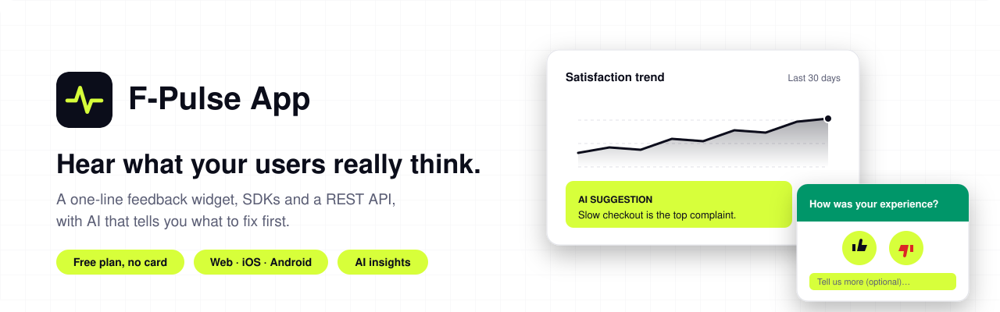
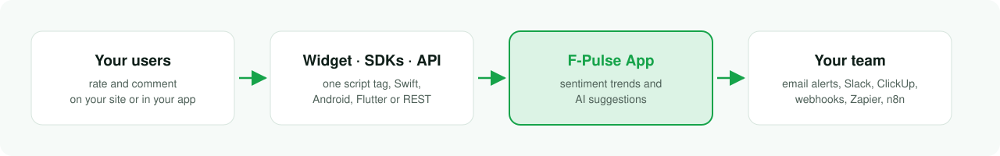
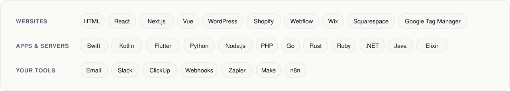
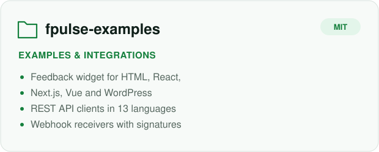
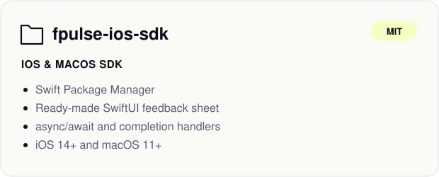
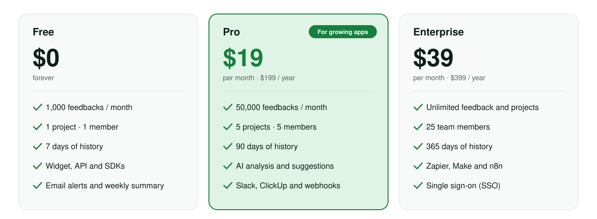

<a href="https://fpulse.app?utm_source=github&utm_medium=org">
  <picture>
    <source media="(prefers-color-scheme: dark)" srcset="assets/banner-dark.svg">
    
  </picture>
</a>

<p align="center">
<a href="https://fpulse.app?utm_source=github&utm_medium=org"></a> <a href="https://fpulse.app/docs?utm_source=github&utm_medium=org"></a> <a href="https://fpulse.app/pricing?utm_source=github&utm_medium=org"></a> <a href="https://fpulse.app/wordpress-plugin"></a> <a href="https://x.com/fpulseapp"></a>
</p>

## What F-Pulse App does

Most users leave without telling you why. F-Pulse App puts a small feedback button in your website or app,
collects a rating and a comment in two clicks, and shows you the trend. Its AI reads every comment and tells you
what to fix first, so you spend your time on what actually matters to your users.

<table>
  <tr>
    <td width="33%" valign="top">
      <h3>One line to install</h3>
      Paste one <code>&lt;script&gt;</code> tag, or use the WordPress plugin. Colors, texts and rating type are set in the dashboard.
    </td>
    <td width="33%" valign="top">
      <h3>Any rating you like</h3>
      Thumbs, emoji, 1-5 stars or NPS, with an optional comment and email. Light, dark or automatic theme.
    </td>
    <td width="33%" valign="top">
      <h3>AI that reads it all</h3>
      Summaries of what users say and concrete suggestions, ranked by what to fix first.
    </td>
  </tr>
  <tr>
    <td width="33%" valign="top">
      <h3>Websites and apps</h3>
      The same dashboard for your site, iOS, Android, Flutter and desktop apps through SDKs and a REST API.
    </td>
    <td width="33%" valign="top">
      <h3>Alerts where you work</h3>
      Email alerts and a weekly summary on every plan, plus Slack, ClickUp and signed webhooks.
    </td>
    <td width="33%" valign="top">
      <h3>Dev and production apart</h3>
      Test feedback stays in its own environment, so your real numbers stay clean.
    </td>
  </tr>
</table>

## How it works

<picture>
  <source media="(prefers-color-scheme: dark)" srcset="assets/how-it-works-dark.svg">
  
</picture>

## Add it in under a minute

**On a website**: copy your snippet from the Widget page of the [dashboard](https://fpulse.app/dashboard/widget?utm_source=github&utm_medium=org) and paste it before `</body>`:

```html
<script src="https://fpulse.app/w/YOUR_WIDGET_ID.js" async></script>
```

**From an app or server**: send feedback with your project API key:

```sh
curl -X POST https://api.fpulse.app/v1/feedback \
  -H "Content-Type: application/json" \
  -H "X-API-Key: fp_your_api_key" \
  -d '{"sentiment": "positive", "comment": "Love the new update", "app_version": "2.1.0", "app_type": "ios"}'
```

Examples for 13 languages, React, Next.js, Vue and webhooks are in [**fpulse-examples**](https://github.com/Fpulse-App/fpulse-examples).

## Works with

<picture>
    <source media="(prefers-color-scheme: dark)" srcset="assets/works-with-dark.svg">
    
  </picture>

## Repositories

<p>
  <a href="https://github.com/Fpulse-App/fpulse-examples">
  <picture>
    <source media="(prefers-color-scheme: dark)" srcset="assets/repo-fpulse-examples-dark.svg">
    
  </picture>
  </a>
  <a href="https://github.com/Fpulse-App/fpulse-ios-sdk">
  <picture>
    <source media="(prefers-color-scheme: dark)" srcset="assets/repo-fpulse-ios-sdk-dark.svg">
    
  </picture>
  </a>
</p>

## Plans

<a href="https://fpulse.app/pricing?utm_source=github&utm_medium=org">
  <picture>
    <source media="(prefers-color-scheme: dark)" srcset="assets/plans-dark.svg">
    
  </picture>
</a>

<p align="center"><a href="https://fpulse.app/auth/register?utm_source=github&utm_medium=org"><b>Start free</b></a>: no credit card needed. Compare every feature on the <a href="https://fpulse.app/pricing?utm_source=github&utm_medium=org">pricing page</a>.</p>

---

<p align="center">
  <a href="https://fpulse.app?utm_source=github&utm_medium=org">Website</a> ·
  <a href="https://fpulse.app/docs?utm_source=github&utm_medium=org">Documentation</a> ·
  <a href="https://fpulse.app/demo?utm_source=github&utm_medium=org">Live demo</a> ·
  <a href="https://fpulse.app/blog?utm_source=github&utm_medium=org">Blog</a> ·
  <a href="https://fpulse.app/contact?utm_source=github&utm_medium=org">Contact</a>
</p>
